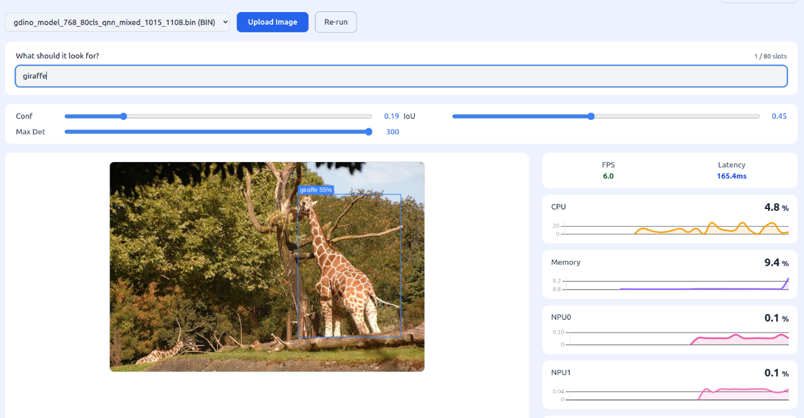
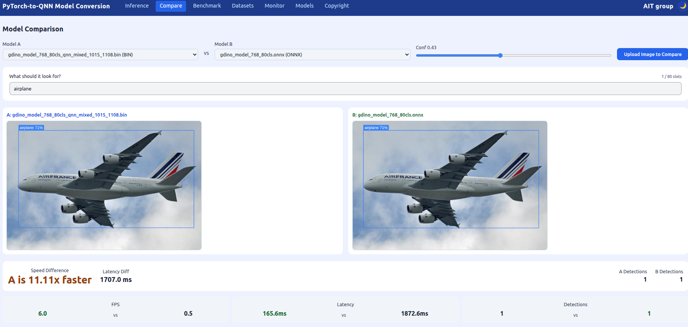

# Qualcomm IQ-9075 Edge AI One-Touch GroundingDINO Model Migration Toolkit

## Advantages of IQ-9075

1. IQ-9075 can provide up to 200 sparse TOPS of AI computing power and supports GPU and DSP accelerated computing
2. The Qualcomm Neural Processing (SNPE) SDK and the Qualcomm AI Engine Direct (QNN) can optimize the performance of trained neural networks
3. It supports Yocto and Ubuntu for AI development

## Performance Metrics

- **AI Model**: Grounding DINO 1.5 Edge (768 × 768) — Open-Vocabulary Object Detection with text prompts (QNN; the text tower runs on the IQ-9075 CPU in 3–11 ms)

| Model | Precision | AP (COCO) | Latency on IQ-9075 (HTP) |
|---|---|---|---|
| Reference | FP32 | 0.462 | — |
| QNN | FP16 | 0.376 | ~290 ms |
| QNN (default) | Mixed (INT8 early layers / FP16 deep layers / INT16 GELU) | 0.437 | ~234 ms |

Evaluated on a 300-image subset of COCO val2017. On-device latency is measured with `qnn-net-run` on the HTP backend.

## Hardware

- **Platform**:  [Qualcomm IQ-9075 EVK](https://www.qualcomm.com/developer/hardware/qualcomm-iq-9075-evaluation-kit-evk)
- **Host PC**: Ubuntu x86_64 PC (no GPU required, 16 GB RAM or more), connected to the EVK over USB (ADB)

## Software & Toolkit

- **Qualcomm AI Runtime (QAIRT) SDK**：v2.47.0
- **System:** Yocto (Qualcomm Linux)
- **Host OS:** Ubuntu 22.04

## Background & Solution

### Motivation

- Creating a One-Touch Toolkit to show Qualcomm Edge AI strength on open-vocabulary detection, where new objects can be found without retraining

### Solution

- One-touch export of a fixed-shape ONNX model from the GroundingDINO source model, then quantization to QNN (Mixed / FP16)
- Type what to look for (for example "cat, remote" or "a person wearing a helmet") and detect it on the IQ-9075 NPU, without retraining or re-converting the model
- On-device QNN benchmark on IQ-9075 EVK: latency and COCO mAP, plus side-by-side comparison of two models

## Architecture Diagram

The architecture diagram shows the toolkit workflow, corresponding to the colors in the legend on the left

Blue Phase: Convert the PyTorch model into a QNN model, and evaluate the benchmark for the QNN model

Purple Phase: Perform real-time inference and display the results based on the converted QNN model

## Demo

Open-vocabulary detection on IQ-9075 EVK with a text prompt ("giraffe")

Model comparison: QNN on the NPU vs. ONNX

## Contact
If you require any further information, please feel free to contact:

TW: qualcomm.tw@aitgroup.com.tw

CN: qualcomm.cn@aitgroup.com.tw
